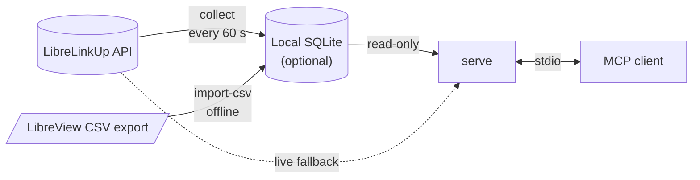

# librelink-mcp-rs

**Give your AI assistant honest, private access to FreeStyle Libre glucose data.**

A local [Model Context Protocol](https://modelcontextprotocol.io/) server, written in Rust, that reads a LibreLinkUp follower account and answers with readings that say exactly how fresh, how complete, and how trustworthy they are.

[](https://github.com/johnohhh1/librelink-mcp-rs/actions/workflows/ci.yml)
[](https://github.com/johnohhh1/librelink-mcp-rs/releases/latest)
[](https://www.rust-lang.org/)
[](LICENSE)

> [!IMPORTANT]
> Unofficial and not affiliated with Abbott. It describes data; it does not diagnose or give treatment advice. Use a LibreLinkUp **follower** account, and enter credentials only in the local `setup` prompt, never in a chat.

## Why this one

- **It never pretends.** A stale reading is labeled `stale`, not served as live. A 12-hour graph is never passed off as a 7-day summary. A gap stays a gap, with a cause attached.
- **It gets the math right.** Time in range is weighted by time, not by sample count, and GMI appears only when the consensus 14-day, 70%-coverage bar is met. On the validated setup, 14-day figures matched LibreView's own AGP report within 1 point on every range band.
- **It stays on your machine.** Credentials live in the OS keychain. Optional history lives in a local SQLite file. The only network destination is LibreLinkUp itself; there is no telemetry.
- **It treats Abbott's servers gently.** One shared client, cached reads, backoff that honors the server's retry times, and no repeated logins after a wrong password, so it won't push the account toward a lockout.

## Quick start

**1. Install.** Download your platform's archive from the [latest release](https://github.com/johnohhh1/librelink-mcp-rs/releases/latest) and check it against `SHA256SUMS`, or build it:

```sh
cargo install --locked --git https://github.com/johnohhh1/librelink-mcp-rs --tag v1.0.0
```

**2. Sign in, locally.**

```sh
librelink-mcp-rs setup            # follower email, hidden password, region
librelink-mcp-rs check            # confirms the connection
```

If the account follows more than one person, run `librelink-mcp-rs select-patient` first.

**3. Connect your MCP client.** On macOS or Windows, open the release's `.mcpb` bundle in Claude Desktop. For any other client, add:

```json
{
  "mcpServers": {
    "librelink": {
      "command": "/absolute/path/to/librelink-mcp-rs",
      "args": ["serve"]
    }
  }
}
```

That's it. Ask your assistant for your current reading, or how the last day looked.

**4. Optional: keep longer history.** LibreLinkUp only holds about 12 hours. Run the collector to build up to 90 days (or more) locally, and import older history from a LibreView export:

```sh
librelink-mcp-rs collect                                            # polls once a minute
librelink-mcp-rs import-csv export.csv --timezone America/Detroit   # backfill from LibreView
```

The [install guide](docs/install.md) covers platform notes, running the collector as a service, and upgrading.

## How it works



While the collector is running, `serve` answers everything from the local database and makes **no** requests to LibreLinkUp. Without it, `serve` reads the live API directly. Every reply says which it used (`data_source: local_store` or `live_api`).

## Tools

| Tool | What it answers |
| --- | --- |
| `get_current_glucose` | The latest reading, its source time, and whether it's `recent`, `stale`, or `unknown` |
| `get_glucose_history` | Readings for the last `hours` (up to 2160 from the local store), paged with `limit` and `before`, each labeled with its source |
| `get_glucose_stats` | Mean, SD and CV, time-weighted time in range across the five consensus bands, and GMI when the data supports it, for the last 1–90 `days` |
| `get_glucose_trends` | Extremes and rates of change for a `daily`, `weekly`, or `monthly` period |
| `get_sensor_info` | Active sensor, activation time, and warmup, with serial and device IDs masked to four characters |
| `validate_connection` | Whether data is reachable and from where, with no glucose values |
| `configure_ranges` | Sets your own target range (mg/dL) |
| `configure_credentials` | Explains the local `setup` command; it accepts no secrets |

There is also a resource, `glucose://current`. Every tool publishes an output schema and MCP annotations; all the data tools are read-only. Error codes and what to do about each are in [troubleshooting](docs/troubleshooting.md).

## Honest data, by design

- **Freshness is explicit.** Readings over 15 minutes old are `stale`. When the time can't be established, freshness is `unknown`. Fetching old data never makes it current.
- **Time is labeled, not guessed.** LibreLinkUp sends timestamps without a timezone. The server infers UTC only when the API's two clocks agree, and says so (`time_basis: factory_utc_inferred`).
- **Coverage is always reported.** Every summary carries its observed span, cadence, and gaps. A window the data doesn't reach is `partial`, and each gap carries a cause, such as `collector_not_running` or `no_data_in_export`.
- **Statistics use time, not counts.** Each reading represents the time until the next one, capped at 15 minutes, so a burst of minute-by-minute readings can't outweigh hours of data, and gaps are never filled in.
- **GMI waits for enough data.** It appears only for 14 or more days at 70% or higher coverage, following the [international consensus on time in range](https://pmc.ncbi.nlm.nih.gov/articles/PMC6973648/). Otherwise you get `null` and the reason.

## Privacy at a glance

- Credentials and the patient selection live in the OS credential store (macOS Keychain, Windows Credential Manager, Linux Secret Service). There is no plaintext fallback, and no MCP tool takes a password.
- The local database holds readings and timestamps keyed by a salted pseudonym. It holds no names, raw patient IDs, credentials, or tokens. On Unix its files are readable only by you.
- CSV import reads only time and glucose columns. Insulin, carbs, notes, and the name line are never stored.
- Errors and logs never contain credentials, IDs, glucose values, or server responses.
- `librelink-mcp-rs clear-local-data` removes everything this project stored.

The full account, covering what's stored, where, what your MCP client sees, and how to delete it, is in [privacy](docs/privacy.md).

## Compatibility

Validated on one US LibreLinkUp follower account with a FreeStyle Libre 3. Other regions, sensors, and clients should work, but are [unvalidated](docs/compatibility.md). If you try one, the compatibility guide shows how to check it and report the result without sharing any readings.

Release binaries cover Linux (x86_64, ARM64), macOS (Apple silicon, Intel), and Windows (x86_64). On Linux, credential storage needs a running Secret Service, such as GNOME Keyring or KWallet.

## Documentation

| Using it | Under the hood |
| --- | --- |
| [Install](docs/install.md) | [Architecture](docs/architecture.md) |
| [Collector](docs/collector.md) | [ADR 0001: owned API client](docs/adr/0001-owned-api-client.md) |
| [CSV import](docs/csv-import.md) | [ADR 0002: local store and collector](docs/adr/0002-local-store-and-collector.md) |
| [Troubleshooting](docs/troubleshooting.md) | [ADR 0003: time-weighted metrics and CSV import](docs/adr/0003-time-weighted-metrics-and-csv-import.md) |
| [Privacy](docs/privacy.md) | [Roadmap](docs/roadmap.md) |
| [Compatibility](docs/compatibility.md) | [Changelog](CHANGELOG.md) |

## Development

```sh
cargo fmt --all -- --check
cargo clippy --all-targets --locked -- -D warnings
cargo test --locked
cargo deny --locked check
```

CI runs these on Linux, macOS, and Windows, plus the minimum supported Rust (1.89). Tests use synthetic data only: please keep real readings, account responses, and credentials out of issues and fixtures. Contributor conventions are in [AGENTS.md](AGENTS.md).

## Acknowledgements

This is an independent Rust implementation of the eight tools from [Amandeep Khurana's LibreLink MCP Server](https://github.com/amansk/librelink-mcp-server). Thank you to Amandeep and its contributors for the original design. None of its code is included here.

FreeStyle Libre, LibreLinkUp, and LibreView are trademarks of Abbott. This project is not affiliated with or endorsed by Abbott.

## License

[MIT](LICENSE)
